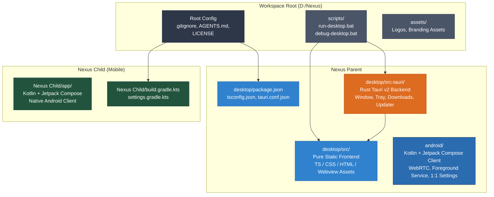

<div align="center">


# **Nexus**

[](https://tauri.app/)
[](https://webrtc.org/)
[](./LICENSE)

*High-performance, privacy-first parental oversight & live surveillance.*

</div>

<div align="center">

<table align="center">
  <thead>
    <tr>
      <th align="center"><b>Nexus Child (Mobile App)</b></th>
      <th align="center"><b>Nexus Parent (Desktop App)</b></th>
    </tr>
  </thead>
  <tbody>
    <tr>
      <td align="center" valign="middle">
        <a href="assets/screenshots/Nexus%20Child.mp4" target="_blank" rel="noopener noreferrer">
          
        </a>
      </td>
      <td align="center" valign="middle">
        <a href="assets/screenshots/Nexus%20Parent.mp4" target="_blank" rel="noopener noreferrer">
          
        </a>
      </td>
    </tr>
  </tbody>
</table>

<p align="center">
  <sub>Looking for video tutorials? Watch the full recorded walkthroughs:</sub><br/>
  <b><a href="assets/screenshots/Nexus%20Child.mp4" target="_blank">Watch Nexus Child Walkthrough (.mp4)</a></b> • 
  <b><a href="assets/screenshots/Nexus%20Parent.mp4" target="_blank">Watch Nexus Parent Walkthrough (.mp4)</a></b>
</p>

</div>

<br/>

## **What is Nexus?**

**Nexus** is a parental oversight & device surveillance ecosystem engineered to safeguard children while guaranteeing absolute end-to-end privacy for families.

Unlike traditional commercial monitoring tools that upload camera feeds, audio recordings, screen captures, and keystrokes to third-party cloud databases, Nexus establishes a direct, hardware-accelerated **WebRTC Peer-to-Peer (P2P)** encrypted bridge between the parent's dashboard and the child's mobile phone. All data streams across encrypted SRTP and SCTP data channels directly between devices, eliminating intermediary cloud exposure.

Nexus is partitioned into two specialized subsystems:

1. **Nexus Parent**: Comprising the **Desktop Dashboard** (`Nexus Parent/desktop`, powered by **Tauri v2**, Rust, and a zero-dependency static TypeScript/CSS frontend inside the native OS WebView) and the **Android Parent Client** (`Nexus Parent/android`, built with **Kotlin**, **Jetpack Compose**, zero-blocker `TextureView` + `EglRenderer` video surface, `io.github.webrtc-sdk:android` WebRTC engine with real-time 10-preset PCM Voice Changer DSP + 36-bar FFT Mic Monitor + Broadcast Intercom, native `MediaCodec`/`MediaMuxer` segmented Rolling DVR + Clip Export, `MediaCodec` + `AudioTrack` 48kHz Opus internal system audio playback, `osmdroid` Esri Satellite / CartoDB Dark Streets live GPS tracking + Nominatim geocoding, cached Remote Storage Explorer with 40-item pagination, preview caching & O(1)-RAM 64KB `.nexuspart` downloads, persistent `dataSync|microphone` background Foreground Service for screen-off resilience, GitHub stable release APK auto-updater + `FileProvider` install flow, 1:1 5-tab settings console with Desktop-parity About/Updater/Alerts, and live DataChannel monitoring/control panels for SMS, Call Log, Notifications, Keyboard Audit, Digital Wellbeing, App Lock, Vibrate & Flash, Call Alerts, and Wallpaper).
2. **Nexus Child (Mobile Client)**: An autonomous Android client written in **Kotlin** integrating device-level telemetry, background accessibility hooks, hardware media capture, Digital Wellbeing usage tracking, active call alerting, and a 5-tier process survival engine.

## **Why Nexus?**

Hi, I'm **Luka Gray (aka Soumo Mukherjee)**.

I initially built an early prototype of this project, but it relied on heavy Electron wrappers, bulky devservers, and fragmented scripts. Electron desktop applications routinely consume 300MB to 500MB of RAM just sitting idle, and routing sensitive family video and audio streams through central servers presents serious privacy and security risks.

When evaluating a complete rewrite, two fundamental architectural goals became non-negotiable:

1. **Zero Bloat & Instant Performance**: By switching to **Tauri v2 and Rust**, the desktop binary launches instantly, requires less than 5MB of memory, and delegates media rendering to native OS WebView hardware acceleration without needing an active Node.js server.
2. **Zero-Trust Family Privacy**: A child's room, screen, and location telemetry belong exclusively to their parents. Nexus replaces middleman cloud storage with cryptographic, direct device-to-device WebRTC data channels and encrypted media pipelines.

## **System Architecture & Feature Mindmap**

Nexus connects the parent console and child device through a high-performance, multi-layered pipeline comprising native hardware controllers, direct peer-to-peer transport, and an edge-to-edge tactical desktop console:

```mermaid
graph TB
    subgraph PARENT["NEXUS PARENT CLIENTS (Desktop Tauri v2 + Android Kotlin)"]
        direction TB
        subgraph P_UI["Tactical B&W Frontend (Desktop TS/CSS & Android Jetpack Compose)"]
            direction TB
            SURV_CAM["Camera Surveillance<br/>• Rear / Front Lens Default & Switch<br/>• Zero-Renegotiation Track<br/>• 15m/30m/60m Rolling DVR Buffer<br/>• Scrubber, Snap-to-Live & Save Clip"]
            SURV_SCR["Screen & System Audio<br/>• Configurable 1080p/720p/540p Stream<br/>• Autonomous Consent Clicker<br/>• Opus WebCodecs Audio (Sink Routed)<br/>• Rolling DVR & MP4/WebM Clip Export"]
            SURV_MIC["Microphone & Voice Intercom<br/>• Live Environmental PCM Audio<br/>• 36-Bar Spectrum & 10-Preset Voice DSP<br/>• Hardware Mic/Speaker & AEC Routing<br/>• Loudspeaker Target Volume (Max/High/Preserve)"]
            SURV_LOC["Tactical Geolocation<br/>• Free Esri Satellite Hybrid Map<br/>• 5m Movement Displacement Filter<br/>• Nominatim Reverse Geocoding<br/>• Tactical Markers & Accuracy Halo"]
            
            AUD_SMS["SMS & Call History<br/>• Latest 100 Initial Snapshot<br/>• Live Telephony ContentObserver<br/>• ContactsContract PhoneLookup"]
            AUD_NOTIF["Notification Interceptor<br/>• Status Bar Snapshot<br/>• Real-Time Push Ingestion<br/>• BigTextStyle & MessagingStyle<br/>• Live Dismissal Synchronization"]
            AUD_KEYS["Keystroke & Input Auditor<br/>• 1500ms Debounced Session Flush<br/>• Window / Focus Shift Commit<br/>• Sensitive Password Masking<br/>• 100-Record Ring Buffer"]
            AUD_FS["Remote Storage Explorer<br/>• 40-Item Progressive Pagination<br/>• Double Cache (Dir + Preview)<br/>• 64KB High-Speed SCTP Stream<br/>• Atomic .nexuspart Disk Downloads"]
            AUD_WELL["Digital Wellbeing Monitor<br/>• Today & 7-Day Usage Timelines<br/>• Hourly/Daily Activity Histograms<br/>• Unlocks, Launches & Active App<br/>• Category Filters & App Breakdown"]
            AUD_ALERTS["Desktop Alerts & Call Guard<br/>• Active Call Banner + 1-Click Mic Listen<br/>• Native OS Tray Notifications<br/>• Low Battery, Selfie & Disconnect Alerts"]
            AUD_LOCK["App Lock & Remote Guard<br/>• 6-Digit SHA-256 Numeric PIN<br/>• 3-Strike Lockout (60s Timer)<br/>• Silent Camera2 Selfie Capture<br/>• Remote Lock / PIN Override"]
            
            ACT_WALL["Wallpaper Management<br/>• Mobile HUD Multi-Screen View<br/>• System vs Lock Differentiation<br/>• Real-Time OnColorsChanged Stream<br/>• 16KB Chunked Remote Push"]
            ACT_HARD["Hardware Actuators<br/>• Vibrator Waveforms (SOS, Pulse)<br/>• Camera Torch (Strobe, Beacon)<br/>• Combined Emergency Alerts"]
            ACT_STEALTH["Stealth Controller<br/>• ARMED / ACTIVE State Badges<br/>• Danger Confirmation Dialog<br/>• Remote Unstealth Broadcast"]
            P_PREFS["5-Tab Preferences Console<br/>• General & System / Auto-Updates<br/>• Audio & Intercom / Surveillance & DVR<br/>• Paired Devices History & About"]
        end
        
        subgraph P_CORE["Native Host Runtimes (Rust Tauri v2 + Android Parent)"]
            RUST_HOST["Desktop Rust Core & Native Services<br/>• System Tray, Autostart & Always-on-Top<br/>• Display Wake Lock (keepawake)<br/>• Atomic Chunked Downloads & Notifications<br/>• GitHub Stable Release Auto-Updater"]
            PA_CORE["Parent Android Core (`NexusParentApplication`)<br/>• `io.github.webrtc-sdk:android` + TextureView + AudioBufferCallback DSP<br/>• `ParentConnectionService` (`dataSync|microphone` + WakeLock)<br/>• `DeviceStateCoordinator` & 9-Attempt Backoff<br/>• `SharedPreferences` History & 1:1 5-Tab Settings"]
        end
    end

    subgraph TRANSPORT["SECURE TRANSPORT & SIGNALING (E2EE Zero-Cloud)"]
        direction TB
        subgraph WEBRTC_PIPE["Encrypted WebRTC P2P Mesh"]
            MEDIA_CH["SRTP Media Pipeline<br/>• Video: Hardware H.264 / VP8<br/>• Audio: 48kHz Opus PCM"]
            DATA_CH["SCTP DataChannel ('nexus-control')<br/>• Bidirectional Ordered Commands<br/>• 64KB High-Speed File Chunks<br/>• 16KB Wallpaper Slices<br/>• Telemetry, Keystrokes & Pings"]
        end
        
        subgraph SIG_PRES["Signaling & Presence (Firebase RTDB)"]
            RTDB_SIG["Fast Non-Trickle ICE<br/>• Embedded Candidates in SDP<br/>• 200-400ms GATHER_ONCE<br/>• Google STUN Infrastructure"]
            PRESENCE["Persistent Presence System<br/>• /.info/connected Listener<br/>• 30s Heartbeat Keep-Alive<br/>• Atomic onDisconnect Hooks"]
        end
    end

    subgraph CHILD["NEXUS CHILD CLIENT (Android Kotlin + Jetpack Compose)"]
        direction TB
        subgraph C_BG["Core Daemon & Revival Engine"]
            BG_SVC["NexusBackgroundService<br/>• Android 14+ Foreground Service<br/>• Indefinite CPU PARTIAL_WAKE_LOCK<br/>• Silent Low-Priority Status Bar"]
            REVIVAL["5-Tier Process Revival<br/>• Tier 1: Boot & Update Receiver<br/>• Tier 2: Screen Unlock Receiver<br/>• Tier 3: Task Kill AlarmManager<br/>• Tier 4: 15-Min Persistent JobService<br/>• Tier 5: Accessibility Keep-Alive"]
            WIDGET["1x1 Recovery Widget<br/>• StealthWidgetProvider<br/>• Launcher Component Toggle<br/>• Zero-Network Unhide Fallback"]
        end
        
        subgraph C_HW["Hardware & Telemetry Controllers"]
            HW_CAM["CameraController<br/>• Camera2 API & EGL Context<br/>• Rear / Front Sensor Enumeration<br/>• Pre-Registered VideoTrack"]
            HW_SCR["ScreenCapturerAndroid<br/>• MediaProjection Hardware Hook<br/>• MediaProjectionAutoClickHelper<br/>• SystemAudioCapturer (Opus)"]
            HW_MIC["Microphone & Speaker<br/>• AudioRecord Hardware Driver<br/>• ParentAudioSpeakerManager<br/>• Max Loudspeaker Override"]
            HW_LOC["LocationController<br/>• FusedLocationProviderClient<br/>• 5m Movement Displacement<br/>• Instant Cached Last-Location"]
            HW_AUDIT["Audit & Telemetry Hooks<br/>• NexusAccessibilityService<br/>• NexusNotificationListenerService<br/>• Telephony, CallAlert & UsageEvents<br/>• 27-Field DeviceTelemetry & SelfieCapturer"]
            HW_ACT["Actuator Controllers<br/>• WallpaperManager Observer<br/>• Vibrator Waveform Engine<br/>• CameraManager Torch Driver"]
        end
    end

    %% Media Feeds
    SURV_CAM <== "SRTP H.264 / VP8 Video" ==> MEDIA_CH
    SURV_SCR <== "SRTP Screen Video" ==> MEDIA_CH
    SURV_MIC <== "SRTP Environmental Audio" ==> MEDIA_CH
    MEDIA_CH <== "Hardware Camera Frames" ==> HW_CAM
    MEDIA_CH <== "Hardware Screen Frames" ==> HW_SCR
    MEDIA_CH <== "Hardware Audio Record" ==> HW_MIC

    %% DataChannel Feeds
    SURV_LOC <== "Location Updates" ==> DATA_CH
    AUD_SMS <== "SMS & Call Logs" ==> DATA_CH
    AUD_NOTIF <== "Push Snapshots" ==> DATA_CH
    AUD_KEYS <== "Debounced Keys" ==> DATA_CH
    AUD_FS <== "64KB File Chunks" ==> DATA_CH
    AUD_WELL <== "Usage Snapshots" ==> DATA_CH
    AUD_ALERTS <== "Call State & Alerts" ==> DATA_CH
    AUD_LOCK <== "Lock & Selfies" ==> DATA_CH
    ACT_WALL <== "Wallpaper Chunks" ==> DATA_CH
    ACT_HARD <== "Actuator Commands" ==> DATA_CH
    ACT_STEALTH <== "Stealth State" ==> DATA_CH

    DATA_CH <== "Displacement Telemetry" ==> HW_LOC
    DATA_CH <== "Telephony, CallAlert & UsageStats" ==> HW_AUDIT
    DATA_CH <== "Status Bar Notifications" ==> HW_AUDIT
    DATA_CH <== "Accessibility Key Events" ==> HW_AUDIT
    DATA_CH <== "Filesystem & MediaStore" ==> HW_AUDIT
    DATA_CH <== "Selfies & Verification" ==> HW_AUDIT
    DATA_CH <== "Wallpaper & Torch State" ==> HW_ACT
    DATA_CH <== "Stealth Toggle Commands" ==> C_BG

    %% Signaling & Presence
    P_CORE -. "Session SDP Handshake" .-> RTDB_SIG
    BG_SVC -. "Session SDP Handshake" .-> RTDB_SIG
    BG_SVC <--> PRESENCE
    P_CORE <--> PRESENCE

    style PARENT fill:#121212,stroke:#333333,color:#ffffff
    style P_UI fill:#181818,stroke:#444444,color:#ffffff
    style P_CORE fill:#1f1f1f,stroke:#555555,color:#ffffff
    style TRANSPORT fill:#0a0a0a,stroke:#2a2a2a,color:#ffffff
    style WEBRTC_PIPE fill:#1a1a1a,stroke:#c53030,color:#ffffff
    style SIG_PRES fill:#1a1a1a,stroke:#dd6b20,color:#ffffff
    style CHILD fill:#121212,stroke:#333333,color:#ffffff
    style C_BG fill:#181818,stroke:#22543d,color:#ffffff
    style C_HW fill:#181818,stroke:#276749,color:#ffffff
```



## **System Capabilities & Technical Specifications**

Nexus unifies live surveillance, forensic auditing, remote device actuation, and process resilience into an end-to-end encrypted, zero-cloud architecture:

| Domain | Subsystem | Capabilities & Core Mechanics | Underlying Engine | Transport & Protocol | Latency / SLA | Cloud Storage |
| :--- | :--- | :--- | :--- | :--- | :--- | :--- |
| **Live Surveillance** | **Camera Feed** | Edge-to-edge hardware video, configurable Rear/Front default & live lens switch, configurable `15m`/`30m`/`60m` rolling DVR buffer, YouTube-style scrubber & snap-to-live, 90° rotation, **Save Clip** (`MP4`/`WebM`) export. | Android Camera2 API, WebRTC Native VideoTrack, MediaRecorder DVR, Chromium Hardware Decoder | SRTP (H.264 / VP8) | $\le 100\text{ ms}$ | **Zero (P2P Direct)** |
| | **Screen Mirror & Audio** | Configurable `1080p`/`720p`/`540p` screen mirror with live quality switching, autonomous consent clicker (`MediaProjectionAutoClickHelper`), synchronized internal system audio routed to chosen PC output speaker, rolling DVR & **Save Clip** export. | Android MediaProjection, EGL Textures, MediaCodec Opus, WebCodecs AudioDecoder, `AudioContext.setSinkId` | SRTP (Video) + DataChannel (`OPUS_AUDIO`) | $\le 120\text{ ms}$ | **Zero (P2P Direct)** |
| | **Mic & Intercom** | Live environmental PCM audio, 36-bar canvas spectrum visualizer, 10-preset real-time Web Audio Voice Changer DSP, hardware mic/speaker selection, AEC/noise suppression toggle, configurable child loudspeaker target volume (`Max`/`High`/`Preserve`), 1-click launch from Active Call Alerts. | Android AudioRecord, AudioManager Loudspeaker Routing, Web Audio API DSP, `MediaDevices` + `setSinkId` | SRTP (48kHz Opus PCM Transceiver) | $\le 60\text{ ms}$ | **Zero (P2P Direct)** |
| | **Tactical Location** | Real-time GPS tracking with 5-meter movement displacement filter, free Esri Satellite Hybrid map (zero API keys), cached Nominatim reverse geocoding, speed & accuracy halos. | Google Play FusedLocationProviderClient, Leaflet, OpenStreetMap Nominatim | SCTP DataChannel (`LOCATION_UPDATE`) | Real-time | **Zero (P2P Direct)** |
| **Telemetry & Auditing** | **Digital Wellbeing** | Exact foreground session reconstruction (`Today` & `7 Days`), 24-hour / 7-day activity histograms, screen time, device unlocks, app launches, active foreground app tracking, and category filtering. | Android `UsageEvents` (`WellbeingUsageAggregator`), `AppOpsManager` Usage Access | SCTP DataChannel (`WELLBEING_*`) | Real-time Poll | **Zero (P2P Direct)** |
| | **Active Call & Desktop Alerts** | Real-time cellular call state alerts (`ringing`, `active`, `idle`) with incoming/outgoing direction, phone number & contact resolution, 30s repeating reminders, actionable banner with 1-click **Turn On Mic**, plus native OS alerts for Intruder Selfies, Low Battery, and Disconnections. | Android `TelephonyCallback` / `PhoneStateListener`, `ContactsContract.PhoneLookup`, Tauri Notification Plugin | SCTP DataChannel (`CALL_STATE`, `CALL_ALERT_*`) | Instant Alert | **Zero (P2P Direct)** |
| | **SMS & Call Logs** | Instant snapshot of latest 100 SMS messages and 100 call records, real-time background ContentObserver streaming, full contact name & caller ID resolution via PhoneLookup. | Android Telephony Provider, ContactsContract.PhoneLookup, ContentObservers | SCTP DataChannel (`SMS_*`, `CALLLOG_*`) | Real-time | **Zero (P2P Direct)** |
| | **Notifications** | Status bar snapshot of active alerts, real-time interception across all apps (WhatsApp, Telegram, etc.), BigTextStyle & MessagingStyle extraction, live dismissal tracking. | Android NotificationListenerService, StatusBarNotification Bridge | SCTP DataChannel (`NOTIFICATION_*`) | Real-time Push | **Zero (P2P Direct)** |
| | **Keystroke Auditor** | 1500ms debounced session aggregation, instant flush on focus/window change, sensitive password & credential masking (`••••••••`), 100-entry in-memory ring buffer. | NexusAccessibilityService, Android InputType / Password Detection | SCTP DataChannel (`KEYBOARD_*`) | Real-time Stream | **Zero (P2P Direct)** |
| | **Storage Explorer** | Progressive 40-item directory pagination, double-layer caching (directoryCache + imagePreviewCache) with delta checks, 160x160 JPEG thumbnails, universal atomic `.nexuspart` disk downloads (default folder or Ask Every Time), remote deletion. | Android Storage Access Framework, File APIs, Rust Chunked `BufWriter` (`downloads.rs`) | SCTP DataChannel (64KB Chunks) | Up to 12 MB/s | **Zero (P2P Direct)** |
| | **App Lock Guard** | 6-digit SHA-256 numeric PIN, 3-strike hardware lockout with 60s persistent timer, silent Camera2 front-camera selfie capture (offscreen ImageReader), remote lock override. | Android Camera2 Offscreen ImageReader, SharedPreferences SHA-256 | SCTP DataChannel (`APPLOCK_*`) | Instant Alert | **Zero (P2P Direct)** |
| **Remote Control & Actuation** | **Wallpaper Control** | Remote Mobile HUD preview distinguishing Home (`FLAG_SYSTEM`) vs Lock (`FLAG_LOCK`) wallpapers, real-time OnColorsChanged streaming, 16KB chunked remote wallpaper push ($\le 10\text{MB}$). | Android WallpaperManager, OnColorsChangedListener | SCTP DataChannel (16KB Chunks) | Instant Sync | **Zero (P2P Direct)** |
| | **Hardware Actuators** | Single-tap vibration patterns (`short`, `double`, `pulse`, `sos`), camera torch modes (`on`, `off`, `strobe`, `beacon`), combined emergency alerts with execution feedback. | Android Vibrator (VibrationEffect waveforms), CameraManager Torch | SCTP DataChannel (`VIBRATE:*`, `FLASH:*`) | $\le 50\text{ ms}$ | **Zero (P2P Direct)** |
| | **Stealth & Widget** | Dynamic app drawer / launcher icon hiding via PackageManager, uninterrupted background daemon execution, 1x1 fail-safe home screen recovery widget, remote desktop sync. | Android PackageManager Component Enabling, StealthWidgetProvider | SCTP DataChannel (`STEALTH_*`) | Instant Toggle | **Zero (P2P Direct)** |
| **Workstation & Infrastructure** | **Desktop Preferences & Lifecycle** | 5-tab Settings console (`General & System`, `Audio & Intercom`, `Surveillance & DVR`, `Paired Devices` multi-device history + 27-field telemetry, `About Nexus Parent`), system tray close-to-tray, OS autostart, `Always on Top`, `Keep Screen On`, GPU toggle, and GitHub stable release auto-updater. | Tauri v2 Plugins (`autostart`, `dialog`, `notification`, `single-instance`), `keepawake`, Rust `tray.rs` & `updater.rs` | Native Tauri IPC + GitHub Releases API | Instant / Background | **Zero (Local Config)** |
| | **Process Survival** | 5-tier process revival (Boot/Update receiver, Screen Unlock receiver, Task Kill AlarmManager, 15-min Persistent JobService, System Accessibility keep-alive). | Android 14+ Foreground Service (`dataSync`, `location`), JobScheduler, AlarmManager, CPU WakeLock | Internal OS Lifecycle & IPC | Autonomous | **Zero (Local Engine)** |
| | **Presence & Signaling** | Fast Non-Trickle ICE with embedded SDP candidates (200-400ms GATHER_ONCE), persistent Firebase presence with `/.info/connected`, 30s heartbeat, atomic onDisconnect hooks, 9-attempt backoff auto-reconnect. | Firebase Realtime Database (RTDB), Google STUN Infrastructure | HTTPS / WSS Non-Trickle SDP | 200–400 ms | Ephemeral SDP Only |

## **Monorepo Layout**

Nexus is structured as a modular monorepo enforcing clear separation between the desktop workstation, mobile client, and documentation:



### Directory Structure

```text
D:\Nexus\
├── assets/                    # Shared brand assets (logos, vector SVGs)
│   ├── logo/                  # nexus-parent.svg, nexus-child.svg
│   └── screenshots/           # Architecture diagrams and UI captures
│
├── docs/                      # Architectural blueprints & implementation specs
│
├── Nexus Child/               # Native Android Mobile Application
│   ├── app/                   # Android application module
│   │   ├── src/main/java/     # Kotlin source code (Services, Controllers, WebRTC)
│   │   ├── src/main/res/      # Android XML drawables, layouts, widget definitions
│   │   └── build.gradle.kts   # App build dependencies & SDK configs
│   └── gradle/                # Gradle wrapper & catalog files
│
├── Nexus Parent/              # Parent Monitoring Clients
│   ├── android/               # Native Android Parent client (Kotlin + Jetpack Compose)
│   │   ├── app/
│   │   │   ├── src/main/java/com/nexus/parent/
│   │   │   │   ├── data/      # DeviceStateCoordinator, DeviceStorage, ReconnectManager, TelemetryParser, Surveillance*/Storage*/Monitor*/Mic* Coordinators
│   │   │   │   ├── media/     # RollingDvrEngine, ClipExportManager, OpusAudioPlayer, media/mic (VoiceChangerDspEngine, AudioSpectrumAnalyzer)
│   │   │   │   ├── service/   # ParentConnectionService (dataSync|microphone), ParentNotificationManager
│   │   │   │   ├── state/     # ParentUiModels, FeatureRegistry, ParentStateHolder
│   │   │   │   ├── webrtc/    # AppConfig, AuthManager, SignalingClient, WebRtcManager, WebRtcExtensions
│   │   │   │   └── ui/        # Monochrome theme, PushDrawer, Home, Surveillance (Camera, Screen+DVR, Storage, Location), Monitor, 1:1 Settings
│   │   │   ├── src/main/res/  # Lucide & loading SVG-derived Vector Drawables, dark #000000 theme
│   │   │   ├── src/test/      # JVM unit tests (telemetry, storage, reconnect, WebRTC, DVR/Opus, Location, state, monitor)
│   │   │   └── build.gradle.kts
│   │   └── gradle/            # Gradle wrapper & version catalog
│   └── desktop/               # Tauri v2 Desktop Application
│       ├── package.json       # Build scripts (npm run build, npm test, tsc)
│       ├── tsconfig.json      # Strict ESNext/Bundler TypeScript configuration
│       ├── src-tauri/         # Rust backend (window, tray, downloads, power, updater, IPC)
│       │   ├── src/           # main.rs, lib.rs, commands.rs, downloads.rs, power.rs, tray.rs, updater.rs
│       │   └── tauri.conf.json# Tauri runtime configuration
│       ├── src/               # Pure static frontend (HTML, CSS, TS, Assets)
│       │   ├── assets/icons/  # Lucide vector icons (SVG)
│       │   ├── css/           # 1:1 Sibling stylesheets
│       │   ├── ts/            # 1:1 Sibling TypeScript controllers & 5-tab settings
│       │   └── index.html     # Edge-to-edge hardware canvas host
│       └── test/              # Node.js unit & integration test suites
│
├── scripts/                   # One-click execution & debug launchers
│   ├── run-desktop.bat        # Automated one-click desktop app runner
│   ├── run-parent-desktop.bat # Dependency check, build, and cargo tauri dev
│   ├── debug-desktop.bat      # VS Code debugger bridge
│   └── debug-parent-desktop.bat
│
├── .vscode/                   # VS Code configuration (tracked in git)
│   ├── launch.json            # "Nexus Parent Desktop (Dev)" F5 runner
│   └── tasks.json             # Build & execution automation tasks
│
├── .gitignore                 # Root gitignore
├── AGENTS.md                  # Core engineering principles & standards
└── README.md                  # Project documentation
```

## **Getting Started**

### For Users

> Download the latest pre-built release for your platform:  
> **[→ Download Nexus Releases](https://github.com/lukagray-dev/Nexus/releases)**

### For Developers

#### Prerequisites

Before building Nexus from source, verify you have the following installed:
- **Node.js**: v20 or later ([nodejs.org](https://nodejs.org/))
- **Rust & Cargo**: Latest stable toolchain ([rustup.rs](https://rustup.rs/))
- **Tauri CLI v2**: `cargo install tauri-cli --version "^2.0"`
- **Android Studio / SDK**: Android SDK API 34+ (required for building **Nexus Child** and **Nexus Parent Android**)

#### Launching Nexus Parent Android (Build & Unit Tests)

From `Nexus Parent/android`:

```powershell
.\gradlew.bat assembleDebug testDebugUnitTest lintDebug --console=plain
```

> Uses Firebase credentials from root `.env` (injected via `BuildConfig` in `app/build.gradle.kts`).

#### Clone the Repository

```bash
git clone https://github.com/lukagray-dev/Nexus.git
cd Nexus
```

#### Launching the Desktop Application (One-Click)

Run the automated launcher script from PowerShell or command prompt:

```powershell
.\scripts\run-desktop.bat
```

#### Running with Visual Studio Code (F5 Debugging)

1. Open the `Nexus` root directory in Visual Studio Code.
2. Press `Ctrl + Shift + D` to open the **Run and Debug** view.
3. Select **"Nexus Parent Desktop (Dev)"** from the dropdown menu.
4. Press `F5` to trigger the automated build pipeline and attach the debugger.

## **License & Contributing**

Nexus is licensed under the **GNU Affero General Public License v3.0 (AGPLv3)**. See [LICENSE](./LICENSE) for full terms.

Contributions are welcome! Before submitting major architectural modifications, protocol additions, or new controller integrations, please review our [CONTRIBUTING.md](./CONTRIBUTING.md) and open an issue for alignment.

---

<div align="center">

<br/>

Built by **Luka Gray (aka Soumo Mukherjee)** • West Bengal, India • 2026  
*"Privacy is not an afterthought; it is the foundation of family safety."*  
**[GitHub](https://github.com/lukagray-dev) • [Instagram](https://www.instagram.com/lukagray.official) • [Email](mailto:heylukagray@gmail.com)**

<br/>

</div>