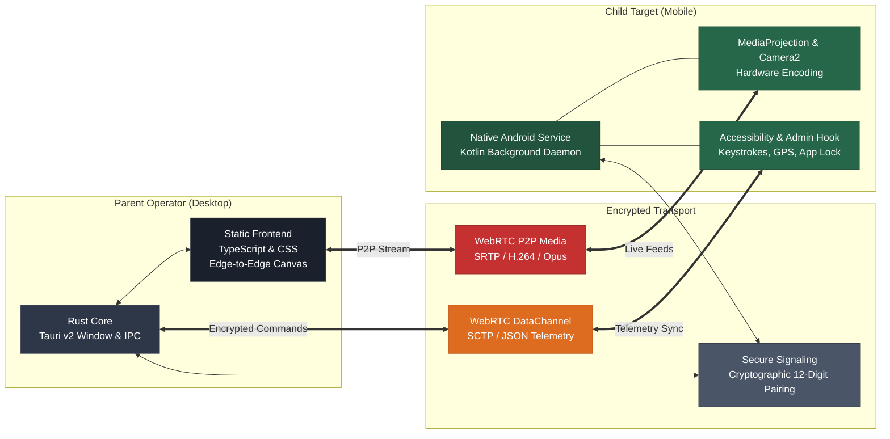
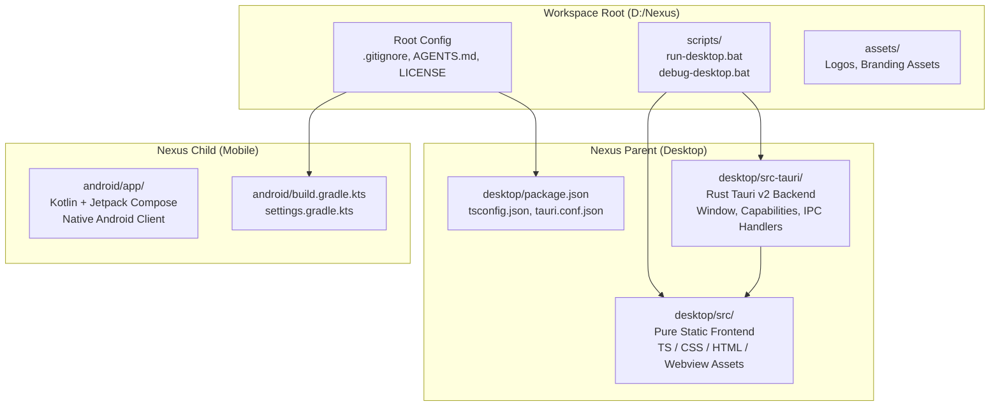

<div align="center">


# **Nexus**

[](https://tauri.app/)
[](https://www.rust-lang.org/)
[](https://www.typescriptlang.org/)
[](https://kotlinlang.org/)
[](https://developer.android.com/compose)
[](https://webrtc.org/)
[](./LICENSE)

<p align="center">
  <b>High-performance, privacy-first parental control, live surveillance, and telemetry platform.</b><br/>
  Engineered with a lightweight Rust backend (Tauri v2), static TypeScript frontend, and native Android client over end-to-end encrypted WebRTC.
</p>

</div>

## **What is Nexus?**

**Nexus** is an industrial-grade parental oversight and device surveillance ecosystem designed to protect children while guaranteeing absolute end-to-end privacy for families. 

Rather than routing private camera feeds, audio captures, and keystroke logs through third-party cloud servers, Nexus establishes a direct, hardware-accelerated **WebRTC Peer-to-Peer (P2P)** encrypted bridge between the parent's desktop console and the child's mobile device.

Nexus is divided into two primary subsystems:

1. **Nexus Parent (Desktop Console)**: A resource-efficient desktop application powered by **Tauri v2** and **Rust**, running a zero-dependency static TypeScript/CSS frontend rendered directly in the OS webview.
2. **Nexus Child (Mobile Client)**: A native Android application written in **Kotlin** and **Jetpack Compose**, integrating device-level telemetry, background accessibility hooks, and low-latency media capture.

## **Why Nexus?**

Hi, I'm **Luka Gray (aka Soumo Mukherjee)**.

I initially built a prototype of this project, but it relied on heavy Electron desktop wrappers, bulky devservers, and fragmented scripts. Electron apps regularly consume 300MB to 500MB of RAM just sitting idle, and routing sensitive family video and audio streams through central servers presents serious privacy and security risks.

When evaluating a complete rewrite, two fundamental architectural goals became non-negotiable:

1. **Zero Bloat & Instant Performance**: By switching to **Tauri v2 and Rust**, the desktop binary launches instantly, requires less than 45MB of memory, and delegates media rendering to native OS WebView hardware acceleration without needing an active Node.js server.
2. **Zero-Trust Family Privacy**: A child's room, screen, and location telemetry belong exclusively to their parents. Nexus replaces middleman cloud storage with cryptographic, direct device-to-device WebRTC data channels and encrypted media pipelines.

> Nexus evolved from an early experimental prototype into an industrial, production-grade security and parental monitoring system.

## **Architecture & Security Model**

Traditional parental monitoring tools rely on continuous cloud uploads, exposing sensitive childhood data to server-side breaches. Nexus operates on an **encrypted direct-device model**:



### Security Highlights
- **Direct P2P Streaming**: Video and audio flow directly over SRTP between devices. No cloud video caching or recording proxies.
- **Cryptographic Device Pairing**: Connections require mutual authorization through an ephemeral 12-digit pairing code.
- **Deny-by-Default Feeds**: All surveillance modules (Camera, Screen, Microphone, Location) initialize in a **strictly paused state**. Feeds only open when the parent explicitly clicks Play.
- **Dynamic Live Badging**: Left sidebar options dynamically display status badges only when that specific feature is streaming live telemetry.
- **Stealth Protection**: Child client runs in silent daemon mode, preventing unauthorized termination or tamper attempts on the target device.

## **Key System Capabilities**

Nexus provides a comprehensive surveillance, communications, and activity oversight suite:

| Category | Capability | Description |
| :--- | :--- | :--- |
| **Live Surveillance** | **Monitor Camera** | Edge-to-edge camera feed, front/rear lens switching, 90° rotation, live timestamps, and clip recording. |
| | **Monitor Screen** | Real-time device screen mirroring with hardware decoding, orientation correction, and video recording. |
| | **Monitor Microphone** | Floating audio monitor with real-time waveform visualization, push-to-talk intercom ("Hold to Speak"), and recording. |
| | **Monitor Location** | Tactical radar vector map, live GPS telemetry (lat, long, velocity, address), geofencing, and 24h route history. |
| **Communications** | **SMS & Calls** | Full SMS thread inspection and categorized call log analyzer (Incoming, Outgoing, Missed). |
| | **Notifications** | Intercepts incoming push notifications from all installed applications in real-time. |
| | **Keyboard / Keylogger** | Complete keystroke capture, search query history, and text entry logging. |
| | **Storage Inspector** | Remote device file browser (Photos, Videos, Audio, Documents, Downloads, APKs). |
| **Social & AI Activity** | **Messaging Apps** | Activity inspection across WhatsApp, Telegram, Snapchat, Instagram, and Facebook. |
| | **AI Chatbot Monitoring**| Monitors prompts and interactions with ChatGPT, Claude, and Grok on the child's device. |
| | **Digital Wellbeing** | App usage breakdowns, screen time limits, and category timers. |
| **Device Controls** | **Stealth Mode** | Arms or disarms silent operation, hiding the application icon on the child device. |
| | **Remote Actions** | Remote vibration trigger, flashlight toggle, wallpaper swap, and selective App Lock. |

## **Monorepo Layout**

The repository is organized into distinct, modular boundaries:



### Directory Structure

```text
D:\Nexus\
├── assets/                    # Shared brand assets (logos, vector SVGs)
│   └── logo/                  # nexus-parent.svg, nexus-child.svg
│
├── docs/                      # Architectural blueprints & agent guides
│   ├── WEBRTC-ARCHITECTURE.md
│   ├── FOLDER-STRUCTURE.md
│   └── UI-PREFERENCES.md
│
├── Nexus Child/               # Native Android Mobile Application
│   ├── app/                   # Android application module
│   │   ├── src/main/java/     # Kotlin + Jetpack Compose source code
│   │   ├── src/main/res/      # Android XML drawables, layouts, themes
│   │   └── build.gradle.kts   # App build dependencies & SDK configs
│   └── gradle/                # Gradle wrapper & version catalogs
│
├── Nexus Parent/              # Parent Monitoring Console
│   └── desktop/               # Tauri v2 Desktop Application
│       ├── package.json       # Build scripts (`npm run build`, `dev`)
│       ├── tsconfig.json      # Strict ESNext/Bundler TypeScript settings
│       ├── src-tauri/         # Rust backend (OS window, capabilities, IPC)
│       └── src/               # Pure static frontend (HTML, CSS, TS, Assets)
│
├── scripts/                   # One-click execution & debug launchers
│   ├── run-desktop.bat        # Automated one-click desktop app runner
│   ├── run-parent-desktop.bat # Dependency check, build, and cargo tauri dev
│   ├── debug-desktop.bat      # VS Code debugger bridge
│   └── debug-parent-desktop.bat
│
├── .vscode/                   # VS Code configuration (tracked in git)
│   ├── launch.json            # "Nexus Parent Desktop (Dev)" F5 runner
│   └── tasks.json             # Build & execution automation tasks
│
├── .gitignore                 # Root gitignore (excludes src/js, target, node_modules)
├── AGENTS.md                  # Core AI agent engineering standards & principles
└── README.md                  # Project overview & documentation
```

## **Key Design Principles**

1. **Separated Sibling Architecture**: Every feature exists in a strict 1:1 sibling arrangement across the Rust backend (`src-tauri/src/`), TypeScript logic (`src/ts/`), and CSS stylesheets (`src/css/`).
2. **Zero-Devserver Static Webview**: The frontend emits no bloated bundle. The webview loads the static HTML, CSS, and compiled scripts directly, eliminating devserver latency and memory overhead.
3. **Tactical B&W Minimalist Aesthetic**: A dark-mode, high-contrast, distraction-free surveillance UI. Strictly vector-driven (SVGs/PNGs) with zero operating system emojis.
4. **Hardware-Decoded WebRTC**: Browsers and modern WebViews possess native, hardware-accelerated H.264/VP8/VP9 and Opus decoders. Nexus leverages these directly to provide sub-100ms video latency.
5. **Deterministic State Synchronization**: All monitoring feeds and inspection panels share a centralized state registry ([state.ts](file:///d:/Nexus/Nexus%20Parent/desktop/src/ts/left-sidebar/state.ts)), ensuring UI badges and background workers stay perfectly in sync.

## **Getting Started**

### Prerequisites
Before building Nexus from source, verify you have the following installed:
- **Node.js**: v20 or later ([nodejs.org](https://nodejs.org/))
- **Rust & Cargo**: Latest stable toolchain ([rustup.rs](https://rustup.rs/))
- **Tauri CLI v2**: `cargo install tauri-cli --version "^2.0"`
- **Android Studio / SDK**: Android SDK API 34+ (for Nexus Child mobile build)

### Quick Start (One-Click)

Clone the repository and launch the desktop application directly from the root:

```bash
git clone https://github.com/lukagray-dev/Nexus.git
cd Nexus
```

Double-click or execute the launcher script in PowerShell:

```powershell
.\scripts\run-desktop.bat
```

The script will automatically:
1. Verify `node`, `npm`, and `cargo` installations.
2. Install any missing Node packages (`npm install`).
3. Compile the TypeScript frontend (`npm run build`).
4. Boot the Tauri v2 desktop application with live hot-reloading.

### Running with VS Code (Run and Debug)

1. Open the `Nexus` folder in Visual Studio Code.
2. Press `Ctrl + Shift + D` to open the **Run and Debug** view.
3. Select **"Nexus Parent Desktop (Dev)"** from the dropdown.
4. Press `F5` (or click the green Play button).

## **License & Contributing**

Nexus is licensed under the **GNU Affero General Public License v3.0 (AGPLv3)**. See [LICENSE](./LICENSE) for the complete legal text.

Contributions are warmly welcomed! Before submitting major architectural changes or new protocol integrations, please review our [CONTRIBUTING.md](./CONTRIBUTING.md) and open an issue for alignment.

---

<div align="center">

<br/>

Built by **Luka Gray (aka Soumo Mukherjee)** • West Bengal, India • 2026  
*"Privacy is not an afterthought; it is the foundation of family safety."*

<br/>

**[GitHub](https://github.com/lukagray-dev) • [Instagram](https://www.instagram.com/lukagray.official) • [Email](mailto:heylukagray@gmail.com)**

<br/>

</div>
